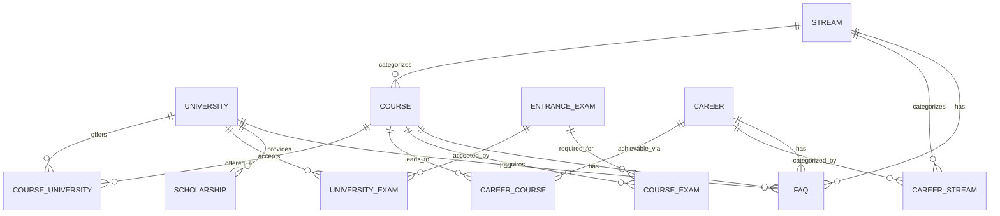

# Database Schema: CareersCompus

This document outlines the complete normalized database schema for CareersCompus, a premium Indian higher-education and career discovery platform. The ORM of choice is Prisma with a PostgreSQL database.

## 1. Entity-Relationship Diagram



## 2. Core Entities

### University

```prisma
model University {
  id              String   @id @default(cuid())
  name            String
  slug            String   @unique
  shortName       String?  // e.g., 'IIT-D'
  description     String   @db.Text
  type            UniversityType
  establishedYear Int?
  
  // Location
  city            String
  state           String
  address         String?
  pincode         String?
  latitude        Float?
  longitude       Float?
  
  // Accreditation & Recognition
  naacGrade       String?  // e.g., 'A++'
  nbaAccredited   Boolean  @default(false)
  ugcRecognized   Boolean  @default(false)
  nirfRanking     Int?     // Overall NIRF ranking
  
  // Media
  logoUrl         String?
  coverImageUrl   String?
  images          String[] // Gallery
  
  // Contact
  website         String?
  email           String?
  phone           String?
  
  // Placement Data
  averagePackage   Decimal? @db.Decimal(10, 2)  // in LPA
  highestPackage   Decimal? @db.Decimal(10, 2)
  placementRate    Float?   // percentage
  
  // Campus
  campusSize       String?  // e.g., '100 acres'
  hasHostel        Boolean  @default(false)
  hostelInfo       String?  @db.Text
  facilities       String[] // Library, Sports, Labs, etc.
  
  // Meta
  isFeatured      Boolean  @default(false)
  isActive        Boolean  @default(true)
  metaTitle       String?
  metaDescription String?
  lastVerified    DateTime?
  sourceUrl       String?  // Official source for data verification
  
  // Relations
  courses         CourseUniversity[]
  entranceExams   UniversityExam[]
  scholarships    Scholarship[]
  faqs            FAQ[]
  
  createdAt       DateTime @default(now())
  updatedAt       DateTime @updatedAt
  
  @@index([state, type])
  @@index([slug])
}
```

### Course

```prisma
model Course {
  id              String   @id @default(cuid())
  name            String
  slug            String   @unique
  level           CourseLevel
  durationYears   Float
  description     String   @db.Text
  
  // Eligibility & Fees
  eligibility     String   @db.Text
  minFee          Decimal? @db.Decimal(10, 2)
  maxFee          Decimal? @db.Decimal(10, 2)
  
  // Details
  curriculum      Json?    // Semester-wise subjects
  specialisations String[]
  
  // Meta
  isActive        Boolean  @default(true)
  isFeatured      Boolean  @default(false)
  lastVerified    DateTime?
  metaTitle       String?
  metaDescription String?
  
  // Relations
  streamId        String
  stream          Stream   @relation(fields: [streamId], references: [id])
  
  universities    CourseUniversity[]
  careers         CareerCourse[]
  entranceExams   CourseExam[]
  faqs            FAQ[]
  
  createdAt       DateTime @default(now())
  updatedAt       DateTime @updatedAt
  
  @@index([streamId, level])
  @@index([slug])
}
```

### Career

```prisma
model Career {
  id                 String   @id @default(cuid())
  name               String
  slug               String   @unique
  description        String   @db.Text
  
  // Details
  responsibilities   String   @db.Text // What the career involves
  skills             String[]
  minSalaryLpa       Decimal? @db.Decimal(10, 2)
  maxSalaryLpa       Decimal? @db.Decimal(10, 2)
  averageSalaryLpa   Decimal? @db.Decimal(10, 2)
  
  // Progression & Growth
  progressionStages  Json?    // e.g., Junior -> Mid -> Senior -> Lead
  growthOutlook      String?  @db.Text
  
  // Meta
  isActive           Boolean  @default(true)
  metaTitle          String?
  metaDescription    String?
  
  // Relations
  courses            CareerCourse[]
  streams            CareerStream[]
  faqs               FAQ[]
  
  createdAt          DateTime @default(now())
  updatedAt          DateTime @updatedAt
  
  @@index([slug])
}
```

### Stream

```prisma
model Stream {
  id              String   @id @default(cuid())
  name            String
  slug            String   @unique
  description     String   @db.Text
  icon            String?  // e.g., Lucide icon name or URL
  color           String?  // Hex color code
  
  // Relations
  courses         Course[]
  careers         CareerStream[]
  faqs            FAQ[]
  
  createdAt       DateTime @default(now())
  updatedAt       DateTime @updatedAt
  
  @@index([slug])
}
```

### EntranceExam

```prisma
model EntranceExam {
  id              String   @id @default(cuid())
  name            String   // e.g., 'JEE Main'
  fullName        String?  // e.g., 'Joint Entrance Examination Main'
  slug            String   @unique
  description     String   @db.Text
  
  conductingBody  String?
  examLevel       ExamLevel
  examMode        ExamMode
  
  eligibility     String   @db.Text
  applicationFee  Decimal? @db.Decimal(10, 2)
  officialWebsite String?
  
  // Relations
  courses         CourseExam[]
  universities    UniversityExam[]
  
  createdAt       DateTime @default(now())
  updatedAt       DateTime @updatedAt
  
  @@index([slug])
}
```

### Scholarship

```prisma
model Scholarship {
  id                 String   @id @default(cuid())
  name               String
  description        String   @db.Text
  provider           String?
  
  eligibility        String   @db.Text
  amount             Decimal? @db.Decimal(10, 2)
  applicationProcess String   @db.Text
  deadline           DateTime?
  officialUrl        String?
  
  // Relations
  universityId       String?
  university         University? @relation(fields: [universityId], references: [id])
  
  createdAt          DateTime @default(now())
  updatedAt          DateTime @updatedAt
}
```

## 3. Junction Tables

### CourseUniversity

```prisma
model CourseUniversity {
  id               String     @id @default(cuid())
  courseId         String
  universityId     String
  
  feesPerYear      Decimal?   @db.Decimal(10, 2)
  totalFees        Decimal?   @db.Decimal(10, 2)
  durationYears    Float?
  seatsAvailable   Int?
  admissionProcess String?    @db.Text
  
  course           Course     @relation(fields: [courseId], references: [id], onDelete: Cascade)
  university       University @relation(fields: [universityId], references: [id], onDelete: Cascade)
  
  @@unique([courseId, universityId])
}
```

### CareerCourse

```prisma
model CareerCourse {
  id               String   @id @default(cuid())
  careerId         String
  courseId         String
  relevanceScore   Int?     // 1 to 10
  
  career           Career   @relation(fields: [careerId], references: [id], onDelete: Cascade)
  course           Course   @relation(fields: [courseId], references: [id], onDelete: Cascade)
  
  @@unique([careerId, courseId])
}
```

### CourseExam

```prisma
model CourseExam {
  id               String       @id @default(cuid())
  courseId         String
  examId           String
  
  course           Course       @relation(fields: [courseId], references: [id], onDelete: Cascade)
  exam             EntranceExam @relation(fields: [examId], references: [id], onDelete: Cascade)
  
  @@unique([courseId, examId])
}
```

### UniversityExam

```prisma
model UniversityExam {
  id               String       @id @default(cuid())
  universityId     String
  examId           String
  
  university       University   @relation(fields: [universityId], references: [id], onDelete: Cascade)
  exam             EntranceExam @relation(fields: [examId], references: [id], onDelete: Cascade)
  
  @@unique([universityId, examId])
}
```

### CareerStream

```prisma
model CareerStream {
  id               String   @id @default(cuid())
  careerId         String
  streamId         String
  
  career           Career   @relation(fields: [careerId], references: [id], onDelete: Cascade)
  stream           Stream   @relation(fields: [streamId], references: [id], onDelete: Cascade)
  
  @@unique([careerId, streamId])
}
```

## 4. Lead/Enquiry System

### Enquiry

```prisma
model Enquiry {
  id               String        @id @default(cuid())
  name             String
  email            String
  phone            String
  
  currentEducation String?
  interestedIn     String?       // Could store course/career/university name/id
  preferredLocation String?
  message          String?       @db.Text
  
  source           String?       // e.g., 'home_page', 'course_xyz'
  status           EnquiryStatus @default(NEW)
  assignedTo       String?       // Admin user ID
  notes            String?       @db.Text
  
  createdAt        DateTime      @default(now())
  updatedAt        DateTime      @updatedAt
}
```

## 5. Admin & User System

### User (Future)

```prisma
model User {
  id               String   @id @default(cuid())
  email            String   @unique
  name             String?
  // ... password, OAuth, etc.
  
  createdAt        DateTime @default(now())
  updatedAt        DateTime @updatedAt
}
```

### Admin

```prisma
model Admin {
  id               String    @id @default(cuid())
  name             String
  email            String    @unique
  passwordHash     String
  role             AdminRole @default(VIEWER)
  
  createdAt        DateTime  @default(now())
  updatedAt        DateTime  @updatedAt
}
```

## 6. Content & Meta

### FAQ

```prisma
model FAQ {
  id               String      @id @default(cuid())
  question         String
  answer           String      @db.Text
  category         String?
  order            Int         @default(0)
  isActive         Boolean     @default(true)
  
  // Optional Relations
  courseId         String?
  universityId     String?
  careerId         String?
  streamId         String?
  
  course           Course?     @relation(fields: [courseId], references: [id], onDelete: Cascade)
  university       University? @relation(fields: [universityId], references: [id], onDelete: Cascade)
  career           Career?     @relation(fields: [careerId], references: [id], onDelete: Cascade)
  stream           Stream?     @relation(fields: [streamId], references: [id], onDelete: Cascade)
  
  createdAt        DateTime    @default(now())
  updatedAt        DateTime    @updatedAt
}
```

### Page

```prisma
model Page {
  id               String   @id @default(cuid())
  slug             String   @unique
  title            String
  content          String   @db.Text
  metaTitle        String?
  metaDescription  String?
  
  createdAt        DateTime @default(now())
  updatedAt        DateTime @updatedAt
}
```

## 7. Enums

```prisma
enum UniversityType {
  CENTRAL
  STATE
  DEEMED
  PRIVATE
  IIT
  IIM
  NIT
  AIIMS
  AUTONOMOUS
}

enum CourseLevel {
  UNDERGRADUATE
  POSTGRADUATE
  DIPLOMA
  CERTIFICATE
  DOCTORAL
}

enum ExamLevel {
  NATIONAL
  STATE
  UNIVERSITY
  PRIVATE
}

enum ExamMode {
  ONLINE
  OFFLINE
  BOTH
}

enum EnquiryStatus {
  NEW
  CONTACTED
  IN_PROGRESS
  CONVERTED
  CLOSED
}

enum AdminRole {
  SUPER_ADMIN
  EDITOR
  VIEWER
}
```

## 8. Indexes

Important indexes defined in models:
- **Unique Slugs**: `@unique` on `slug` for University, Course, Career, Stream, EntranceExam, Page.
- **Composite Indexes**: 
  - `@@index([streamId, level])` on `Course`
  - `@@index([state, type])` on `University`
- **Foreign Keys**: Managed by Prisma but recommended to add explicit indexes if not automatically generated for specific query patterns (e.g., junction tables have `@@unique` which creates an index).
- **Full-Text Search**: In PostgreSQL, we can use Prisma's `search` preview feature or raw SQL for GIN indexes on `name` and `description` fields.

## 9. Data Integrity Rules

- **Uniqueness**: All slugs must be unique per entity type.
- **Soft Deletes**: Use the `isActive` boolean flag for logical deletion of `Course`, `University`, `Career`, `FAQ`.
- **Cascading**: Added `onDelete: Cascade` on junction tables (`CourseUniversity`, `CareerCourse`, `CourseExam`, `UniversityExam`, `CareerStream`, `FAQ`).
- **Required vs Optional**: 
  - Essential metadata like `name` and `slug` is required.
  - Optional fields like `shortName`, `averagePackage`, `logoUrl`, etc., use `?` (nullable).
  - Enums ensure valid status/type tracking.

## 10. Seed Data Strategy

- **Structure**: Create a `prisma/seed.ts` script.
- **Sample Data**: Include at least 5 streams, 10 careers, 20 courses, 10 universities, and related exams to test relationships.
- **Workflow**: 
  1. Upsert Streams
  2. Upsert Careers & Entrance Exams
  3. Upsert Courses (link to Streams)
  4. Upsert Universities
  5. Link all many-to-many relationships (CourseUniversity, CareerCourse, etc.)
- Data can be loaded from static JSON files in `prisma/data/` for maintainability.

## 11. Scaling Considerations

- **Target Size**: 1000+ courses, 300+ universities, 100+ careers, 15+ streams.
- **Pagination**: 
  - Use **cursor-based pagination** (`cursor` + `take`) in public API for infinite scroll/large lists to ensure performance.
  - Use **offset pagination** (`skip` + `take`) for admin tables where specific page jumps are needed.
- **Caching**: 
  - Use Next.js 14 App Router data caching and revalidation.
  - Redis can be integrated for expensive queries (e.g., home page aggregate data).
- **Full-Text Search**: 
  - Phase 1: PostgreSQL `tsvector` via Prisma `search` functionality.
  - Phase 2: Migrate to Algolia, Meilisearch, or Typesense for typo-tolerance and faceted search as data grows.
