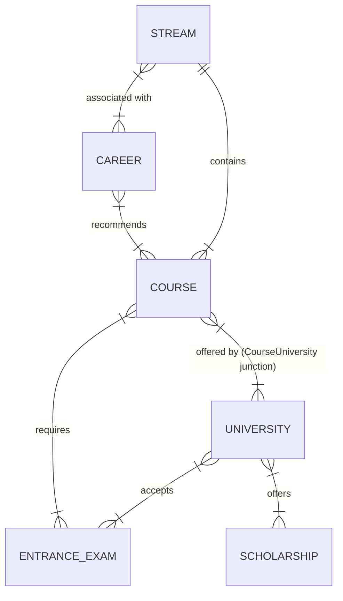

# Information Architecture: CareersCompus

This document defines the Information Architecture (IA) for CareersCompus, an intelligent, premium higher-education and career discovery platform designed to guide students through the complex journey from career aspiration to university admission.

---

## 1. Site Map

The platform is structured hierarchically, ensuring intuitive navigation and clear distinct pathways for exploratory, directed, and administrative tasks.

```text
/                           → Homepage
├── /courses                → Course catalogue (filterable, paginated)
│   └── /courses/[slug]     → Course detail page
├── /universities           → University catalogue (filterable, paginated)
│   └── /universities/[slug]→ University detail page
├── /careers                → Career catalogue
│   └── /careers/[slug]     → Career detail page
├── /streams                → Streams overview
│   └── /streams/[slug]     → Stream landing page (courses + universities in stream)
├── /compare                → Comparison tool (supports courses, universities)
├── /counselling            → Multi-step counselling flow
├── /search                 → Search results page
├── /about                  → About CareersCompus
├── /contact                → Contact page
├── /privacy                → Privacy policy
├── /terms                  → Terms of service
└── /admin                  → Admin dashboard (protected)
    ├── /admin/courses      → Manage courses
    ├── /admin/universities → Manage universities
    ├── /admin/careers      → Manage careers
    ├── /admin/streams      → Manage streams
    ├── /admin/leads        → Manage enquiries/leads
    └── /admin/settings     → Platform settings
```

---

## 2. Entity Relationships

The data model powering the IA is highly interconnected, facilitating rich discovery and comparison. 

The **KEY relationship chain** driving the user journey is:
**CAREER → COURSE → UNIVERSITY → ADMISSION**



---

## 3. Navigation Architecture

### Primary Navigation (Desktop)

| Position | Item | Type | Behavior |
|----------|------|------|----------|
| Left | Logo (CareersCompus) | Link | → Home `/` |
| Center | Home | Link | → `/` |
| Center | Courses | Mega menu | Dropdown displaying streams + popular courses |
| Center | Universities | Mega menu | Dropdown displaying states + featured universities |
| Center | Careers | Link | → `/careers` |
| Center | Compare | Link | → `/compare` |
| Right | Search icon | Button | Opens global search overlay |
| Right | Get Guidance | CTA Button | → `/counselling` or opens modal form |

### Mobile Navigation
- **Trigger:** Hamburger menu (right-aligned in top header).
- **Behavior:** Full-screen overlay with staggered Framer Motion animation.
- **Structure:** Accordion sub-menus for Courses and Universities to save vertical space.
- **CTAs:** Prominent 'Get Guidance' CTA pinned at the bottom; global search accessible directly from the persistent top bar.

### Secondary Navigation (Desktop Only)
A "Streams" sub-bar appears below the main navigation on the homepage and catalogue pages to encourage exploration by interest area.
*Items:* Engineering | Medical | Management | Law | Science | Commerce | Arts | Education

---

## 4. Page-Level Information Architecture

### 1. Homepage (`/`)
- **Purpose:** Brand introduction, primary entry point, and routing hub.
- **Primary Intent:** Discover what the platform offers and start exploring (via search or streams).
- **Content Hierarchy:**
  1. Interactive 3D Career Compass Hero with Global Search and quick-link tags.
  2. Stream Cards Grid (explore by domain).
  3. Popular Courses Grid.
  4. Featured/Top Universities Grid.
  5. Trust Signals & Testimonials.
  6. Free Counselling CTA section.
  7. Global Footer.
- **Primary CTA:** Global Search / "Get Guidance".
- **Internal Linking:** Links to all major catalogue pages, popular courses, and top universities.

### 2. Course Catalogue (`/courses`)
- **Purpose:** Browse and filter all available courses.
- **Primary Intent:** Find a course matching specific criteria (stream, level, duration).
- **Content Hierarchy:** Page Header (Title + Breadcrumbs) → Filter Sidebar (Stream, Level, Duration) → Active Filters List → Sort Dropdown → Paginated Course Cards.
- **Primary CTA:** "View Details" (on course cards).
- **Secondary CTA:** "Compare" (checkbox on cards).
- **Internal Linking:** To Course Detail pages.
- **Breadcrumb:** Home > Courses

### 3. Course Detail (`/courses/[slug]`)
- **Purpose:** Provide exhaustive information about a specific course.
- **Primary Intent:** Evaluate if the course is right for the user and where to study it.
- **Content Hierarchy:** Hero (Title, key stats, quick actions) → About / Overview → Eligibility Criteria → Curriculum/Syllabus by semester → Top Colleges offering the course → Associated Careers → Related Courses.
- **Primary CTA:** "Apply for Counselling" / "Get Guidance".
- **Internal Linking:** To offering Universities, related Careers, and sibling Courses.
- **Breadcrumb:** Home > Courses > [Stream] > [Course Name]

### 4. University Catalogue (`/universities`)
- **Purpose:** Browse and filter universities and colleges.
- **Primary Intent:** Find a university by state, type, or stream focus.
- **Content Hierarchy:** Header → Filter Sidebar (State, City, Type, Approvals) → Sort Options → Paginated University Cards.
- **Primary CTA:** "View University" / "View Courses".
- **Internal Linking:** To University Detail pages.
- **Breadcrumb:** Home > Universities

### 5. University Detail (`/universities/[slug]`)
- **Purpose:** Comprehensive profile of an educational institution.
- **Primary Intent:** Assess university quality, campus life, and course offerings.
- **Content Hierarchy:** Hero (Gallery, Name, Location, Accreditation) → About → Highlights/Rankings → Courses Offered (grouped by stream) → Admissions & Exams accepted → Placements → Scholarships → Campus/Facilities.
- **Primary CTA:** "Apply Now" (if affiliated) or "Get Counselling".
- **Internal Linking:** To specific Course Detail pages.
- **Breadcrumb:** Home > Universities > [State] > [University Name]

### 6. Career Catalogue (`/careers`)
- **Purpose:** Inspire and guide users toward professional paths.
- **Primary Intent:** Explore career options and understand the pathway to achieve them.
- **Content Hierarchy:** Header → Filter/Category Tags → Grid of Career Cards (with salary/growth snapshots).
- **Primary CTA:** "Explore Career".
- **Breadcrumb:** Home > Careers

### 7. Career Detail (`/careers/[slug]`)
- **Purpose:** In-depth guide to a specific profession.
- **Primary Intent:** Understand day-to-day work, earning potential, and the educational path required.
- **Content Hierarchy:** Hero (Title, average salary, growth rate) → Role description → Required Skills → Educational Pathway (Step-by-step) → Recommended Courses → Top Universities for this path.
- **Primary CTA:** "Explore Recommended Courses".
- **Internal Linking:** To Recommended Courses and Universities.
- **Breadcrumb:** Home > Careers > [Career Name]

### 8. Stream Landing Page (`/streams/[slug]`)
- **Purpose:** A hub for a specific academic domain (e.g., Engineering).
- **Content Hierarchy:** Hero → About Stream → Popular Courses in Stream → Top Universities in Stream → Career Opportunities.
- **Primary CTA:** "Browse All [Stream] Courses".
- **Breadcrumb:** Home > Streams > [Stream Name]

### 9. Comparison Page (`/compare`)
- **Purpose:** Side-by-side comparison of entities.
- **Content Hierarchy:** Search/Add Entity inputs → Dynamic Comparison Table (Highlighting differences).
- **Primary CTA:** "Choose this Course/University".
- **Breadcrumb:** Home > Compare

### 10. Counselling Page (`/counselling`)
- **Purpose:** Lead generation and user assistance.
- **Content Hierarchy:** Multi-step wizard: 1. Basic Info → 2. Academic Background → 3. Interests/Goals → 4. Preferred Contact Method.
- **Primary CTA:** "Submit Request".

### 11. Search Results (`/search`)
- **Purpose:** Display comprehensive results for global queries.
- **Content Hierarchy:** Query summary → Tabbed results (All, Courses, Universities, Careers) → Result list.

### 12. About Page (`/about`)
- **Purpose:** Brand story, mission, and team.
- **Content Hierarchy:** Hero → Mission/Vision → Why Choose Us → Team → Contact/Location.

### 13. Contact Page (`/contact`)
- **Purpose:** Provide support and communication channels.
- **Content Hierarchy:** Contact Form → Direct Info (Phone, WhatsApp, Email) → Office Location Map.

---

## 5. Content Taxonomy

To maintain structured and standardized data, the following taxonomies are enforced:

### Streams
- Engineering & Technology
- Medical & Health Sciences
- Management & Business
- Law & Legal Studies
- Science
- Commerce & Finance
- Arts & Humanities
- Design
- Education
- Computer Applications
- Agriculture
- Media & Communication
- Psychology

### Course Levels
- Undergraduate (UG)
- Postgraduate (PG)
- Diploma
- Certificate
- Doctoral

### University Types
- Central University
- State University
- Deemed University
- Private University
- IIT / IIM / NIT / AIIMS
- Autonomous Institute

### Course Durations
- 1 Year
- 2 Years
- 3 Years
- 4 Years
- 5 Years (Integrated)
- 5.5 Years

---

## 6. Search Architecture

The search functionality is designed to be the fastest path to discovery.
- **Global Indexing:** Indexes Courses, Universities, Careers, Streams, and Entrance Exams.
- **Autocomplete:** Rich dropdown suggestions combining all entity types as the user types.
- **Faceted Search:** Available on catalogue pages to filter search results by taxonomy tags.
- **Empty States:** Displays "Popular Searches" and "Trending Courses" when the query is empty or yields no results.
- **Client-side Storage:** Recent searches are stored in `localStorage` for quick access.
- **Result Grouping:** Results are distinctly categorized (e.g., separating a "B.Tech" course from an "IIT Delhi" university).

---

## 7. Internal Linking Strategy

Robust internal linking is crucial for SEO and keeping users engaged in the exploration loop.
- **Course Pages →** Link out to: related courses, universities offering the course, careers requiring the course, and the parent stream.
- **University Pages →** Link out to: courses offered, related universities (nearby or similar rank).
- **Career Pages →** Link out to: recommended educational pathways (courses) and relevant universities.
- **Stream Pages →** Link out to: all constituent courses and careers.
- **Global →** Every page must feature at least one "Get Guidance" / Counselling CTA to drive conversions.

---

## 8. URL Strategy

URLs must be clean, semantic, lowercase, and use hyphens for separation to maximize readability and SEO impact.

**Patterns:**
- `/courses/btech-computer-science`
- `/universities/iit-delhi`
- `/careers/software-engineer`
- `/streams/engineering`
- `/compare?type=course&items=btech-cs,btech-it`
