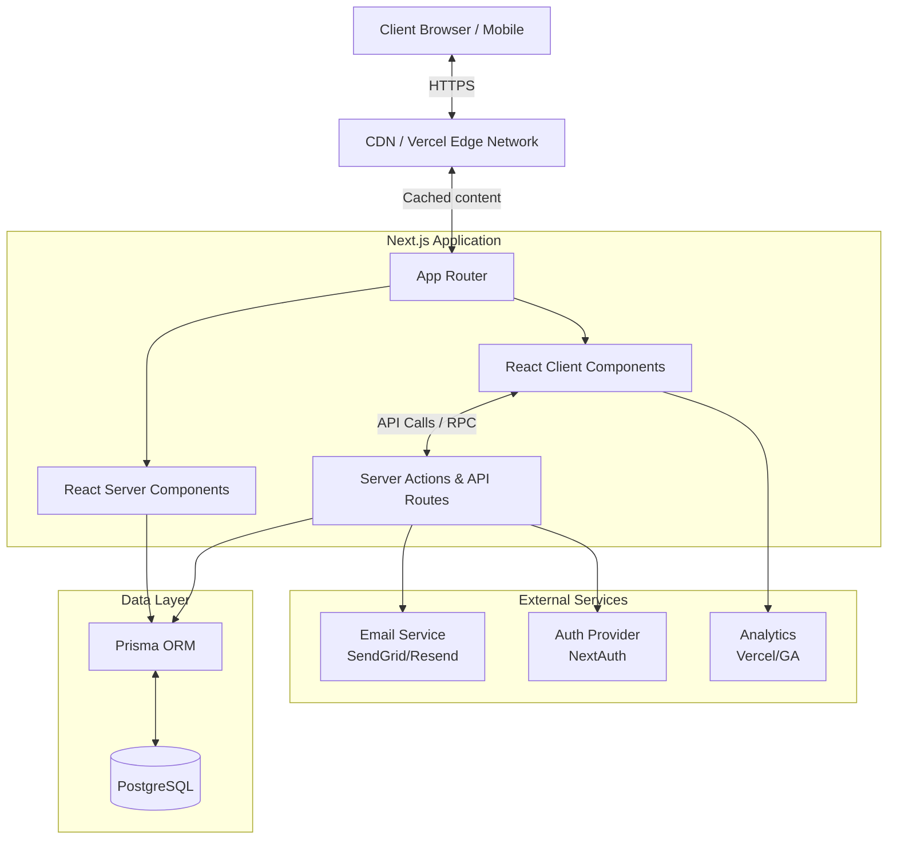

# CareersCompus Technical Architecture

This document outlines the technical architecture for CareersCompus — a premium Indian education and career discovery platform. It serves as the single source of truth for engineering decisions, infrastructure design, and application structure.

---

## 1. Architecture Overview

The system follows a modern edge-first, decoupled architecture using the Next.js App Router, combining Server-Side Rendering (SSR), Incremental Static Regeneration (ISR), and Client-Side Rendering (CSR) for optimal performance and SEO.



---

## 2. Tech Stack Specification

We utilize a modern, type-safe stack optimized for developer experience, scale, and end-user performance.

### Frontend
| Technology | Version | Purpose |
|---|---|---|
| Next.js | 14.x+ | Framework (App Router) |
| React | 18.x+ | UI Library |
| TypeScript | 5.x | Type safety |
| Tailwind CSS | 3.4+ | Styling |
| shadcn/ui | latest | Base UI components |
| Lucide React | latest | Icons |
| Framer Motion | 11.x+ | Animations |
| Three.js | latest | 3D rendering for Career Compass |
| @react-three/fiber | latest | React Three.js renderer |
| @react-three/drei | latest | Three.js helpers |

### Backend
| Technology | Version | Purpose |
|---|---|---|
| Next.js App Router | 14.x+ | Backend logic via Server Actions / API |
| Prisma | 5.x+ | Object-Relational Mapping (ORM) |
| PostgreSQL | 15+ | Relational Database |
| Zod | 3.x | Schema Validation |
| React Hook Form | 7.x | Form state management |

### DevOps
| Technology | Purpose |
|---|---|
| Vercel | Hosting, Serverless Functions & CDN |
| GitHub | Version control |
| GitHub Actions | CI/CD pipelines |
| Prisma Migrate | Database migrations |

---

## 3. Project Structure

The project structure is organized by feature and function within the Next.js App Router paradigm.

```text
careerscompus/
├── app/
│   ├── (public)/              # Public routes group (shares layout)
│   │   ├── page.tsx           # Homepage
│   │   ├── layout.tsx         # Public layout with nav + footer
│   │   ├── courses/
│   │   │   ├── page.tsx       # Course catalogue
│   │   │   └── [slug]/
│   │   │       └── page.tsx   # Course detail
│   │   ├── universities/
│   │   │   ├── page.tsx       # University catalogue
│   │   │   └── [slug]/
│   │   │       └── page.tsx   # University detail
│   │   ├── careers/
│   │   │   ├── page.tsx       # Career catalogue
│   │   │   └── [slug]/
│   │   │       └── page.tsx   # Career detail
│   │   ├── streams/
│   │   │   └── [slug]/
│   │   │       └── page.tsx   # Stream landing
│   │   ├── compare/
│   │   │   └── page.tsx       # Comparison tool
│   │   ├── counselling/
│   │   │   └── page.tsx       # Multi-step counselling
│   │   ├── search/
│   │   │   └── page.tsx       # Search results
│   │   ├── about/
│   │   │   └── page.tsx       # About page
│   │   ├── contact/
│   │   │   └── page.tsx       # Contact page
│   │   ├── privacy/
│   │   │   └── page.tsx       # Privacy policy
│   │   └── terms/
│   │       └── page.tsx       # Terms of service
│   ├── admin/                 # Admin routes (protected)
│   │   ├── layout.tsx         # Admin layout
│   │   ├── page.tsx           # Admin dashboard
│   │   ├── courses/           # Manage courses
│   │   ├── universities/      # Manage universities
│   │   ├── careers/           # Manage careers
│   │   ├── streams/           # Manage streams
│   │   ├── leads/             # Manage counselling leads
│   │   └── settings/          # System settings
│   ├── api/                   # API routes (Webhooks, External integrations)
│   │   ├── search/            # Fallback search API
│   │   ├── enquiry/           # Lead ingestion API
│   │   ├── admin/             # Admin specific API
│   │   └── revalidate/        # On-demand ISR webhooks
│   ├── layout.tsx             # Root layout (Html, Body, Providers)
│   ├── globals.css            # Global Tailwind & custom styles
│   ├── loading.tsx            # Global loading state
│   ├── error.tsx              # Global error boundary
│   └── not-found.tsx          # 404 page
├── components/
│   ├── ui/                    # shadcn/ui base components (buttons, inputs)
│   ├── layout/                # Header, Footer, Nav, MobileNav
│   ├── home/                  # Homepage specific sections
│   │   ├── CareerCompass.tsx  # 3D hero component
│   │   └── [Section].tsx      # Other modular sections
│   ├── course/                # Course-related UI components
│   ├── university/            # University-related UI components
│   ├── career/                # Career-related UI components
│   ├── search/                # Search overlay & inputs
│   ├── compare/               # Side-by-side comparison tables
│   ├── counselling/           # Multi-step form wizards
│   ├── three/                 # 3D/Three.js primitives and scenes
│   └── shared/                # Reusable common components
├── lib/
│   ├── db.ts                  # Prisma client singleton
│   ├── utils.ts               # General utility functions (clsx, tailwind-merge)
│   ├── validations.ts         # Zod schemas for form/API validation
│   ├── constants.ts           # Global configuration constants
│   ├── seo.ts                 # Metadata and JSON-LD structured data generators
│   └── fonts.ts               # next/font configurations
├── hooks/                     # Custom React hooks (e.g., useDebounce, useMediaQuery)
├── types/                     # Shared TypeScript interfaces & types
├── prisma/
│   ├── schema.prisma          # Database schema definition
│   ├── migrations/            # Auto-generated SQL migrations
│   └── seed.ts                # Database seeder script
├── public/                    # Static assets
│   ├── images/                # Static images
│   ├── icons/                 # SVG icons
│   ├── robots.txt             # Search engine crawling rules
│   └── sitemap.xml            # Auto-generated sitemap index
├── styles/                    # Additional global CSS if required
├── docs/                      # Architectural & feature documentation
├── .env.example               # Environment variable templates
├── next.config.js             # Next.js compiler configuration
├── tailwind.config.ts         # Tailwind design tokens
├── tsconfig.json              # TypeScript compilation rules
└── package.json               # Dependencies and scripts
```

### Rationale for Structure
- **App Router Grouping**: `(public)` and `admin` logic is segregated, ensuring admin layouts don't leak into the public site, optimizing chunks.
- **Component Colocation**: Features like `course`, `university`, and `home` have dedicated component folders to prevent the `components/` directory from becoming a monolith.
- **Prisma isolation**: All DB definitions exist natively in `prisma/` standardizing the ORM approach.
- **Centralized Lib**: Shared utilities and business logic configurations sit in `/lib`.

---

## 4. Data Fetching Strategy

CareersCompus heavily relies on React Server Components (RSC) to maximize SEO, performance, and reduce client-side bundle size.

### Server Components (Default)
- Utilized for all catalogue (courses, universities, careers), detail, and static pages.
- Database access is handled directly within the component via Prisma, negating the need for intermediary API endpoints for data hydration.

### Client Components
- Prefixed with `"use client"`.
- Utilized strictly for interactive elements:
  - Multi-step counselling forms (React Hook Form)
  - 3D/Three.js Hero section
  - Filter state management
  - Search overlay and autocomplete

### Caching Strategy
- **Static Pages (SSG/ISR)**: Pages updated infrequently are statically generated with ISR revalidation.
- **Dynamic Data**: Forms and admin panels use Server Actions with `revalidatePath` or `revalidateTag` to update cache on mutation.
- **Client-Side Data**: SWR or React Query is used for highly interactive client-side fetching (e.g., search autocomplete).
- **CDN**: Next.js automatically caches static assets (images, fonts, bundles) at the Edge with long TTLs.

---

## 5. Rendering Strategy

We apply specific rendering strategies tailored to the performance and freshness requirements of each route.

| Page | Strategy | Revalidation | Rationale |
|---|---|---|---|
| Homepage | ISR | 1 hour | High traffic, mostly static, occasionally updated featured content. |
| Course catalogue | ISR | 1 hour | Listing data changes infrequently. |
| Course detail | ISR | 24 hours | Deep content pages rarely change; optimized for TTFB and SEO. |
| University catalogue| ISR | 1 hour | Listing data changes infrequently. |
| University detail | ISR | 24 hours | Static details optimized for search engines. |
| Career catalogue | ISR | 1 hour | Discovery page. |
| Career detail | ISR | 24 hours | Deep static content. |
| Stream landing | ISR | 1 hour | Curation page. |
| Search | SSR / CSR | None (dynamic) | User queries demand real-time database lookups. |
| Compare | CSR | None | User-selected entities compared dynamically on the client. |
| Counselling | CSR | None | Interactive multi-step user session. |
| Admin | CSR / SSR | None (protected)| Real-time CMS data, requires authentication and accurate state. |

---

## 6. API Design

While Server Actions handle most mutations, we expose specific API Routes for external integrations and specific client use cases.

- `POST /api/enquiry` — Submits a counselling enquiry. (Used by forms, potentially external partners/landing pages).
- `GET /api/search?q=...` — Global search with autocomplete. Returns debounced results for client-side search UI.
- `POST /api/admin/courses` — CRUD operations for courses (used primarily by the admin dashboard).
- `POST /api/admin/universities` — CRUD operations for universities.
- `POST /api/revalidate` — Webhook to trigger on-demand ISR revalidation (e.g., when a CMS editor updates a university, this endpoint invalidates the specific path cache).

---

## 7. Authentication Architecture

For v1, authentication is strictly for platform administrators.

- **Provider**: NextAuth.js (Auth.js) or equivalent secure abstraction.
- **Strategy**: Credential-based login (Email/Password).
- **Sessions**: Stateless JWT tokens stored in secure, HttpOnly cookies.
- **RBAC**: Role-based access control implemented at the middleware level.
  - *SuperAdmin*: Full system access.
  - *Editor*: Can modify content, cannot view system settings.
  - *Viewer*: Read-only access to admin panels.

---

## 8. 3D Component Architecture

The "Career Compass" interactive 3D hero is a key differentiator but must not degrade performance for low-end devices.

- **Dynamic Loading**: `next/dynamic` is used to load `@react-three/fiber` and `@react-three/drei` dynamically. SSR is disabled for 3D components.
- **Graceful Fallback**: A static WebP image or lightweight CSS animation is shown:
  - During the initial SSR payload and client hydration.
  - If WebGL is unavailable on the device.
  - If the user prefers reduced motion (`@media (prefers-reduced-motion: reduce)`).
- **Lazy Execution**: 3D assets are loaded only when the Hero section is visible in the viewport using Intersection Observer.

---

## 9. Performance Architecture

CareersCompus targets premium performance metrics to enhance user trust and SEO rankings.

### Bundle Optimization
- Component-level code splitting provided out-of-the-box by Next.js App Router.
- Heavy dependencies (Three.js, visual charts) are dynamically imported.
- Automated image optimization via `next/image` (WebP/AVIF formats, exact sizing).
- Zero-layout-shift font loading via `next/font`.

### Core Web Vitals Targets
- **LCP (Largest Contentful Paint)**: < 2.5s (Critical CSS, optimized LCP image/fallback).
- **FID/INP (First Input Delay / Interaction to Next Paint)**: < 200ms (Minimized main-thread blocking JS).
- **CLS (Cumulative Layout Shift)**: < 0.1 (Strict image dimensions, reserved spaces for async components).
- **TTFB (Time to First Byte)**: < 600ms (Edge caching, Edge network routing).

### Monitoring
- Vercel Analytics for real user monitoring (RUM) of Web Vitals.
- Sentry (or equivalent) for real-time error tracking and profiling.

---

## 10. Security

Enterprise-grade security measures are applied across the stack.

- **Transport**: HTTPS enforced on all environments.
- **Input Sanitization**: Strict schema validation using Zod for all incoming data (Forms, APIs).
- **Rate Limiting**: Implemented via Vercel Edge Middleware or Redis on public mutation endpoints (`/api/enquiry`).
- **CSRF**: Server actions and API routes protected by Next.js built-in CSRF defenses.
- **Headers**: Strict Content Security Policy (CSP), X-Frame-Options, and X-Content-Type-Options via `next.config.js`.
- **Database**: SQL Injection prevented natively by Prisma ORM's parameterized queries.
- **XSS**: React's default escaping mitigates cross-site scripting, bolstered by CSP.

---

## 11. Deployment Architecture

- **Hosting**: Vercel. Chosen for native Next.js optimization, edge caching, and seamless CI/CD.
- **Database**: PostgreSQL hosted on a managed provider (e.g., Neon, Supabase, or Railway) configured with connection pooling (PgBouncer) to handle Serverless connection spikes.
- **Environments**:
  - `Production`: Main branch deployments.
  - `Preview`: Ephemeral environments generated automatically for every Pull Request.
- **Configuration**: Environment variables securely managed within Vercel.

---

## 12. Error Handling

A robust, user-friendly error handling strategy ensures system resilience.

- **UI Boundaries**: Next.js `error.tsx` boundaries wrap route segments to catch and isolate runtime React errors without crashing the whole app.
- **404 Handling**: Custom `not-found.tsx` to catch dead links and guide users back to valid streams/courses.
- **API Responses**: Standardized JSON error response shapes for all API routes (e.g., `{ error: true, message: string, code: number }`).
- **Client Feedback**: Toast notifications (`sonner` or `react-hot-toast`) for form submission errors and client-side mutations.
- **Server Logging**: Unhandled exceptions logged to monitoring service for engineering review.
